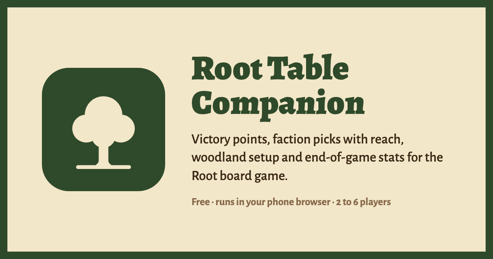
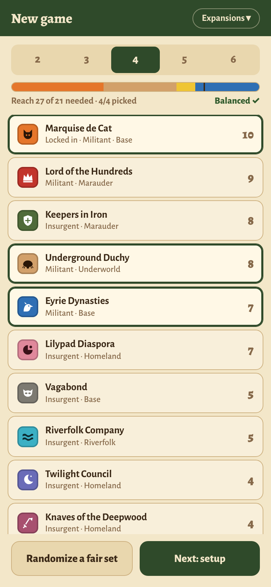
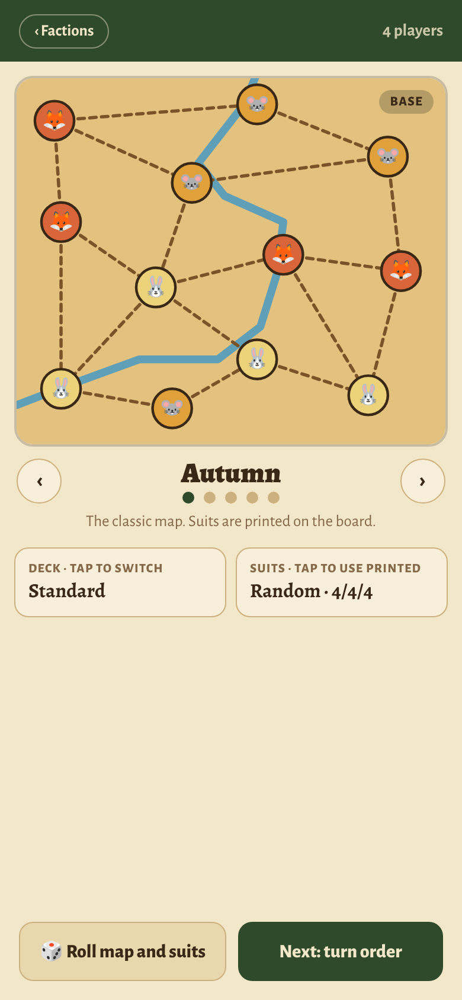
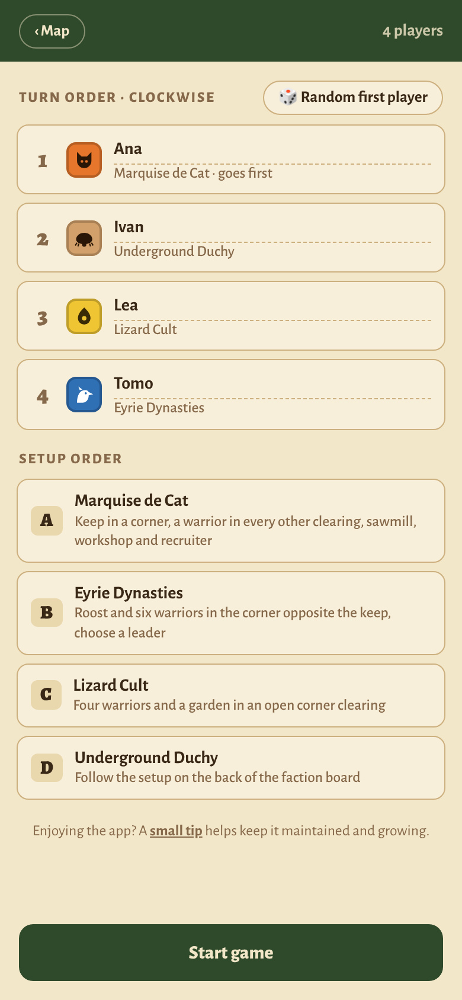
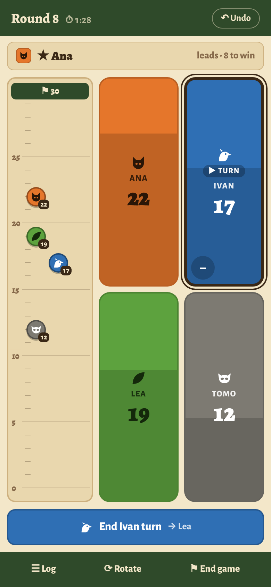
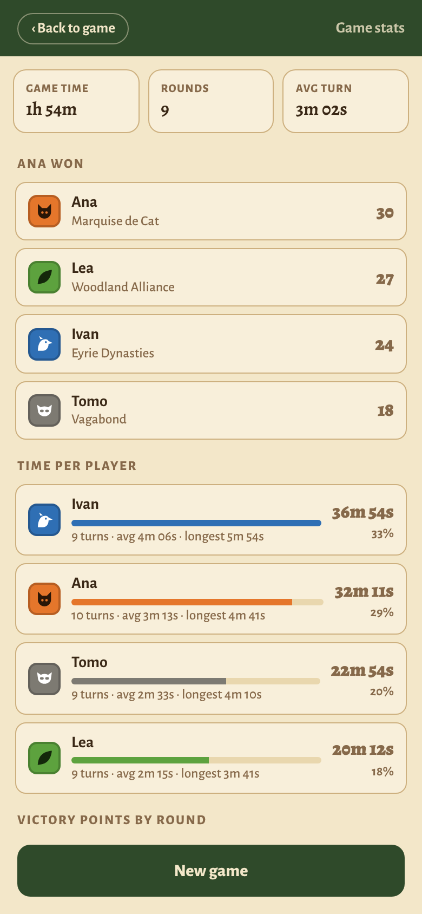
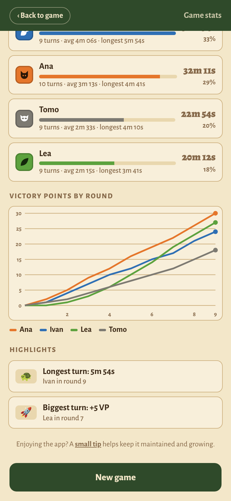

<div align="center">



<h3>Score tracker, faction picker and woodland setup for the <em>Root</em> board game</h3>

<p>
  <a href="https://mariorozic.github.io/RootCalculator/"></a>
</p>

<p>
  
  
  
  
  
  
</p>

</div>

---

Put one phone in the middle of the table and let it handle the bookkeeping. **Root Table Companion** helps you pick a fair set of factions, deal the woodland, run through setup in the right order, keep score for everyone, and see how the game went once someone hits 30.

No account, no ads, nothing to install. It runs in the browser and keeps your game on the device, so a refresh or a locked screen never loses the score.

## ✨ What it does

<table>
  <tr>
    <td width="33%" align="center"></td>
    <td width="33%" align="center"></td>
    <td width="33%" align="center"></td>
  </tr>
  <tr>
    <td valign="top"><b>🎯 Pick fair factions</b><br/>Choose 2 to 6 players and the expansions you own. A live meter adds up each faction's <b>reach</b> against the minimum from the Law of Root. Tap to lock a faction in, tap again to exclude it, then <i>Randomize a fair set</i> fills the rest with a balanced lineup that always includes a militant faction.</td>
    <td valign="top"><b>🗺️ Set up the woodland</b><br/>Swipe through the Autumn, Winter, Lake, Mountain and Gorge maps. Use the printed suits or deal random clearings, switch between the Standard and Exiles and Partisans decks, or roll the map and suits in one tap.</td>
    <td valign="top"><b>🎲 Turn and setup order</b><br/>Name each player, roll a random first player, and get the setup order (A, B, C…) with a short reminder of what every faction puts on the board.</td>
  </tr>
  <tr>
    <td width="33%" align="center"></td>
    <td width="33%" align="center"></td>
    <td width="33%" align="center"></td>
  </tr>
  <tr>
    <td valign="top"><b>🏆 Keep score</b><br/>Big faction tiles: tap for +1, hold for a pad with +1 to +7 and minus values. A score ruler shows the race to 30, the leader line shows who is ahead, and the turn button tracks rounds and passes play clockwise. Dominance cards, Vagabond coalitions, a full log, undo, and a rotate mode for players on the far side of the table are all built in. The screen stays awake while you play.</td>
    <td valign="top"><b>⏱️ Game stats</b><br/>When the game ends you get total game time, rounds played, average turn length, final standings, and how long each player spent on their turns.</td>
    <td valign="top"><b>📈 How the game went</b><br/>A victory points by round chart shows every comeback and runaway lead, plus highlights like the longest turn and the biggest scoring turn.</td>
  </tr>
</table>

## 🌲 Factions and expansions

| Box | Factions |
| --- | --- |
| **Base** | Marquise de Cat · Eyrie Dynasties · Woodland Alliance · Vagabond |
| **Riverfolk** | Lizard Cult · Riverfolk Company · Second Vagabond |
| **Underworld** | Underground Duchy · Corvid Conspiracy |
| **Marauder** | Lord of the Hundreds · Keepers in Iron |
| **Homeland** | Lilypad Diaspora · Twilight Council · Knaves of the Deepwood |

Turn off any box you don't own and its factions and maps drop out of the picks and random draws.

## 📱 Use it at the table

1. Open **[mariorozic.github.io/RootCalculator](https://mariorozic.github.io/RootCalculator/)** on a phone or tablet.
2. Add it to your home screen (Share → *Add to Home Screen* on iOS, or *Install app* on Android) so it opens full screen like a native app.
3. Lay it flat between the players and start a new game.

## 🛠️ Run it locally

You need Node.js 24 (the version the deploy uses).

```bash
git clone https://github.com/MarioRozic/RootCalculator.git
cd RootCalculator
npm install
npm run dev
```

Then open http://localhost:5173.

| Command | What it does |
| --- | --- |
| `npm run dev` | Start the dev server with hot reload |
| `npm run build` | Type-check and build to `dist/` |
| `npm run preview` | Serve the production build locally |
| `npm run lint` | Lint with Oxlint |

## 🧱 How it's built

- **React 19 + TypeScript**, bundled with **Vite**. No UI library, just hand-written CSS in `src/index.css`.
- All game state lives in one reducer in `src/game.ts` and is saved to `localStorage` after every change.
- Faction data (reach, setup order, colours) is in `src/data/factions.ts`, and the maps and clearing layouts are in `src/data/maps.ts`.
- Every push to `main` is built and deployed to **GitHub Pages** by `.github/workflows/deploy.yml`.

```
src/
├── screens/      PickFactions → Woodland → Setup → Score → Stats
├── components/   Faction icons, map drawing, support link
├── data/         Factions, reach values, maps and decks
└── game.ts       Game state, actions and persistence
```

## ☕ Support

If the app makes your game nights smoother, a [small tip](https://revolut.me/rozic_m) helps keep it maintained and growing. Bug reports and ideas are welcome in [Issues](https://github.com/MarioRozic/RootCalculator/issues).

---

<sub>Root Table Companion is an unofficial fan project and is not affiliated with Leder Games. <i>Root</i> and its factions are trademarks of Leder Games.</sub>
